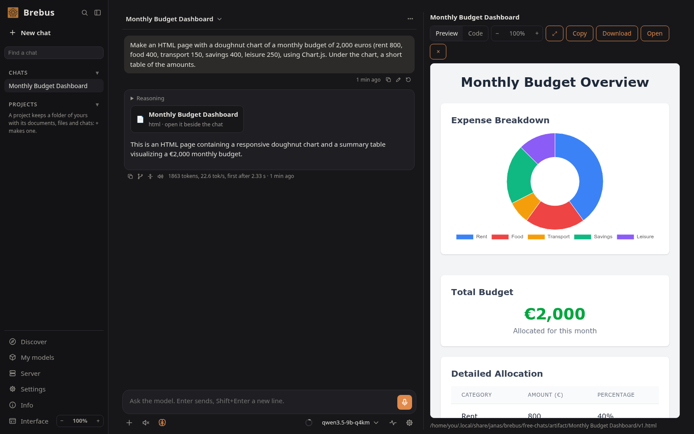

# Brebus

**AI models on your own computer, in a window of their own, with no cloud.** Brebus is the app of [Janas](https://github.com/prabanta-dev/janas): chats and projects with the models of your computer, your documents searched and given to them, artifacts, code run in a cage, voice, tools, and a server for other programs. Nothing leaves the computer unless you ask it to: the models run on it, your chats and documents stay on it.

> **Download Brebus only from here** and from [Janas's releases](https://github.com/prabanta-dev/janas/releases). Other sites using these names are not the project's.

## Download

| | |
|---|---|
| **Windows** 10 (1903 or later) and 11, x86-64 | [brebus-windows-x86_64-setup.exe](https://github.com/prabanta-dev/brebus/releases/latest/download/brebus-windows-x86_64-setup.exe), or without installing: [brebus-windows-x86_64.zip](https://github.com/prabanta-dev/brebus/releases/latest/download/brebus-windows-x86_64.zip) (unpack it, start `brebus.exe`) |
| **Linux** x86-64, Ubuntu 22.04, Debian 12 and later | [brebus_amd64.deb](https://github.com/prabanta-dev/brebus/releases/latest/download/brebus_amd64.deb) (`sudo apt install ./brebus_amd64.deb`), or without installing: [brebus-linux-x86_64.tar.gz](https://github.com/prabanta-dev/brebus/releases/latest/download/brebus-linux-x86_64.tar.gz) (unpack it, start `./brebus`) |
| **Linux** x86-64, with .rpm packages | [brebus.x86_64.rpm](https://github.com/prabanta-dev/brebus/releases/latest/download/brebus.x86_64.rpm) (`sudo dnf install ./brebus.x86_64.rpm`) |
| **Linux** x86-64, Arch and the systems made from it (CachyOS, EndeavourOS, Manjaro...) | [brebus.x86_64.pkg.tar.zst](https://github.com/prabanta-dev/brebus/releases/latest/download/brebus.x86_64.pkg.tar.zst) (`sudo pacman -U ./brebus.x86_64.pkg.tar.zst`) |

The SHA-256 of every file: `SHA256SUMS` in the [release](https://github.com/prabanta-dev/brebus/releases/latest). Each release of Brebus is built from the sources of the [release of Janas](https://github.com/prabanta-dev/janas/releases) of the same version, by GitHub. Installing and removing it, step by step: [the guide](https://github.com/prabanta-dev/janas/blob/main/docs/brebus.md#install-it).

- **Windows** warns that the setup is from an unknown publisher (Windows protected your PC): it is not signed yet. *More info*, then *Run anyway*.
- **Linux**: the .deb, the .rpm and the pacman package put Brebus in `/opt/brebus-janas`, `brebus` on the PATH and in the desktop's menu; removing the package takes it all away (your chats and models are yours, in your home). The window is WebKitGTK's (`libwebkit2gtk-4.1-0` on Debian and Ubuntu, `webkit2gtk4.1` with .rpm, `webkit2gtk-4.1` on Arch, recommended by the packages); where it is missing, or there is no display, Brebus opens its page in the browser.

## What it does

- **The models**: a catalog of models already converted, and any model of Hugging Face, downloaded and checked; each file of the Hub says how far it is from running on this computer. Several models loaded at once, each chosen in a click.
- **Chats and projects**: a project works in a folder of yours. Your documents there - PDF, Word, Excel, PowerPoint, LibreOffice, web pages, EPUB - are searched before each question and given to the model with their names.
- **Replies written in full Markdown**: lists, tables, task lists, quotes, code, formulas. The reader passes all 652 examples of the CommonMark 0.31.2 specification and the 51 of GitHub's extensions.
- **Long chats**: when a chat fills the model's memory, the model summarizes the earlier messages and goes on from the summary; how much it keeps in mind is chosen in tokens, up to what each model takes (262,144 for Qwen3.5).
- **Reasoning** seen while the model works, turned on or off for each chat, for the models that reason.
- **Every message a point to go back to**: change a question and ask again, go back to it, or branch a new chat from a reply to try another way.
- **Artifacts**: pages, apps, charts and documents made by the model open beside the chat, each with its versions and its own zoom.
- **Run code**: Python run by the model in a cage, with no network and no access to your files beyond the project.
- **Voice**: speech to text with Whisper, replies read aloud.
- **Tools**: Janas's services (weather, maps, files, git, Wikipedia...) and any MCP server.
- **A server for other programs**: the model loaded answers editors and other apps through an API that follows OpenAI's, Ollama's and Anthropic's.
- **Started at login**, if you like, without its window: the model you used last ready for other programs.
- **Served from a browser**, to the users of a machine, with a login, a second factor and HTTPS.
- **The size of the whole window** at the side bar's foot, or with Ctrl+wheel.

The guide to all of it, from installing it to every button, with what to do when something goes wrong: [docs/brebus.md](https://github.com/prabanta-dev/janas/blob/main/docs/brebus.md).

## How it works

Brebus is a small program that shows its page in a window (WebView2 on Windows, WebKitGTK on Linux) and carries Janas's tools beside it: `janas-get` downloads the models, and each model loaded runs in a `janas-server` of its own, on this computer only. The engine, Janas-LLM, measures the machine - memory, CPU, GPU through Vulkan, the NPU of Intel's Core Ultra, the NVMe SSD - and chooses how to run each model; a mixture of experts larger than the memory runs, its experts read from the disk as they are needed. Its performance, measured against llama.cpp: [Janas's README](https://github.com/prabanta-dev/janas#measured-performance).

## Sources, problems, licence

Brebus is part of **Janas**: its sources, documentation and issues are at [github.com/prabanta-dev/janas](https://github.com/prabanta-dev/janas) (`src/brebus/`). **A problem with Brebus, or an idea: [open an issue at Janas](https://github.com/prabanta-dev/janas/issues/new)**, saying it is about Brebus, its version (Info) and your system. This repository only hosts the releases: its issues send you there.

Brebus and Janas are free software under the GNU General Public License, version 3 or later ([LICENSE](LICENSE)), by **Maurizio "camauri" Cammalleri**.
